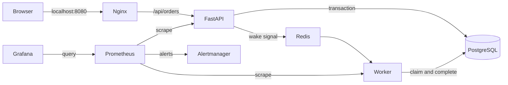

# Architecture

ReleaseOps is a local order-processing platform with asynchronous fulfillment,
containerized services, two CI integrations, and a separate Kubernetes deployment.
Orders are synthetic; no payments or personal information are collected.

## Request and processing path

1. Nginx serves the browser assets and forwards API requests to `api:8000`.
2. FastAPI validates product/quantity and checks an optional Idempotency-Key.
3. PostgreSQL stores the order transactionally before the API returns HTTP 202.
4. Redis publishes a wake signal. Its failure does not undo the accepted record.
5. The worker claims database rows, processes synthetic fulfillment and commits
   completion. Polling recovers missed notifications; expired leases recover claims
   abandoned by a crashed worker. PostgreSQL row locks coordinate concurrent workers.
6. A retry with the same key/payload returns the existing order; changed payload
   with that key returns HTTP 409. Callers should supply keys for retry safety.

`/health` reports process responsiveness. `/ready` checks database and Redis
availability. Neither means every accepted order has completed. Worker heartbeat,
queue depth and completion metrics cover the background path separately.

Readiness deliberately requires Redis even though durable processing can continue
without its wake hints. This makes dependency loss visible and drains a Kubernetes
API pod during that drill. A service whose availability policy treats Redis as
optional could instead gate readiness only on PostgreSQL and expose Redis as a
degraded metric; that policy change must update probes and recovery checks together.

## Deployment ownership

| Layer | Owner | Scope |
| --- | --- | --- |
| Local service topology | Docker Compose | Containers, bridge network and named volumes |
| Local cluster | kind | One Kubernetes control-plane node container |
| Cluster platform policies | Terraform | Namespace, quota, default limits, workload service account |
| Application workloads | Kustomize/kubectl | Services, Deployments, StatefulSet, PVC and migration Job |
| Hosted CI | GitHub Actions | Checks, image build, scan and disposable integration |
| Local CI and preview release | Jenkins | Same checks plus an explicitly selected local preview release |
| Visibility | Prometheus/Grafana/Alertmanager | Metrics, dashboard, alert evaluation and local grouping |

Terraform and Kustomize do not own the same objects. Hosted runners do not receive
credentials or network access to a private laptop cluster. Jenkins uses a separate
agent and a TLS Docker-in-Docker engine rather than the controller's host socket.

## Design decisions

- PostgreSQL is authoritative; Redis notification loss cannot remove queued work.
- SQLite isolates unit tests; Compose tests exercise the real PostgreSQL/Redis path.
- Nginx gives browser assets and the API one origin, without browser CORS configuration.
- uv locks dependencies; Docker builds a fresh virtual environment inside the image.
- Shared scripts keep Jenkins and GitHub Actions checks aligned.
- Compose is the simplest complete local runtime; Kubernetes is an alternative
  runtime with explicit probes, limits, persistence and rollout controls.
- Terraform owns a small platform boundary so state and workload lifecycles stay clear.
- Services bind published ports to loopback. Database and Redis are not published.
- Optional stacks reduce memory use. One laptop is not independent failure domains
  or high availability; persistent kind data is lost if its cluster is deleted.

## Current boundaries

No public application authentication, payment processing, cloud infrastructure,
remote state backend, external paging integration, managed database failover or
automatic production release is configured. The initial schema command creates
missing tables; existing-schema upgrades require versioned migrations. Synthetic
fulfillment can safely retry, while real external effects need their own idempotency.
