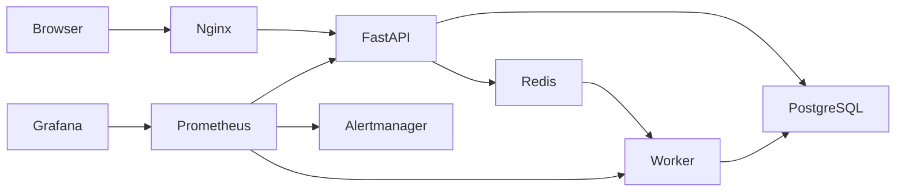

# ReleaseOps

A containerized order-processing platform with asynchronous workers, repeatable
delivery workflows, infrastructure as code, and operational monitoring.

The browser submits synthetic orders. FastAPI persists each accepted order in
PostgreSQL, Redis wakes a worker, and the worker records completion. Database
polling and claim leases recover missed notifications and interrupted processing.



## Capabilities

- Order submission, recent orders, status tracking, validation and idempotent retries.
- Non-root application containers, locked Python dependencies and shared checks.
- Docker Compose deployment with persistent PostgreSQL storage and health checks.
- GitHub Actions CI: lint, format, tests, disposable integration and image scanning.
- Local Jenkins controller/agent with an isolated TLS Docker engine and optional
  deployment to a persistent preview environment.
- Local Kubernetes deployment using kind, Kustomize, probes, resource limits,
  a StatefulSet and a schema initialization Job.
- Terraform-managed namespace, resource quota, defaults and workload identity.
- Prometheus metrics, Grafana dashboard, local alerts, backup/restore and recovery checks.

This runs on an existing computer without an AWS account, card or cloud resources.
It uses synthetic orders and localhost access. A single computer does not provide
high availability; external payments, public authentication and managed failover
are outside the current scope.

## Start with Docker Compose

Use an Ubuntu/WSL terminal in this repository. Docker Desktop must be running with
WSL integration enabled for that Ubuntu distribution. `docker version` must show
both Client and Server. See [complete setup](docs/DEPLOYMENT.md) for downloads and
the optional Jenkins, Kubernetes and monitoring environments.

```bash
bash scripts/local-secrets.sh       # Once: creates ignored local credentials
bash scripts/build.sh               # Builds API/worker and browser images
docker compose up -d --wait         # Starts database, Redis, schema, API, worker and web
docker compose exec -T -e BASE_URL=http://web:8080 api python - < scripts/smoke.py
```

Open [ReleaseOps](http://127.0.0.1:8080). Submit an order and watch it change from
queued to completed. Stop with `docker compose down`; named database volumes are
retained. **`down --volumes` deletes this deployment's stored data.**

## Development and verification

Python 3.14.9 is managed separately from Ubuntu's system Python by uv 0.13.5.

```bash
uv python install
bash scripts/check.sh               # Locked install, Ruff, formatting and pytest
bash scripts/compose-smoke.sh       # Disposable real-database integration deployment
bash scripts/recovery-check.sh     # Redis/worker recovery against the running main stack
bash scripts/scan-images.sh         # Trivy HIGH/CRITICAL gate for both runtime images
```

The CI workflow and Jenkins pipeline reuse these scripts. Integration containers
and volumes have a unique project name and are removed afterward. The recovery
check adds a synthetic order to the main deployment and restores stopped services.

| Endpoint | Contract |
| --- | --- |
| `GET /health` | Process responsiveness |
| `GET /ready` | Database and Redis availability; 503 on dependency failure |
| `POST /api/orders` | 202 accepted; optional `Idempotency-Key`; 409 on changed-key reuse |
| `GET /api/orders` | Recent orders; bounded `limit` |
| `GET /api/orders/{id}` | Order status; 404 for unknown UUID |
| API `GET /metrics` | Prometheus metrics, internal container port 8000 |

## Documentation

- [Architecture and design decisions](docs/ARCHITECTURE.md)
- [Installation, configuration and deployment](docs/DEPLOYMENT.md)
- [Operations, recovery and release runbooks](docs/OPERATIONS.md)
- [Validation evidence and current limits](docs/VERIFICATION.md)

Repository secrets, local environment files, Terraform state, database dumps and
generated environments are excluded from Git. Review changes and scan results
before release; a successful build alone does not prove service health.
